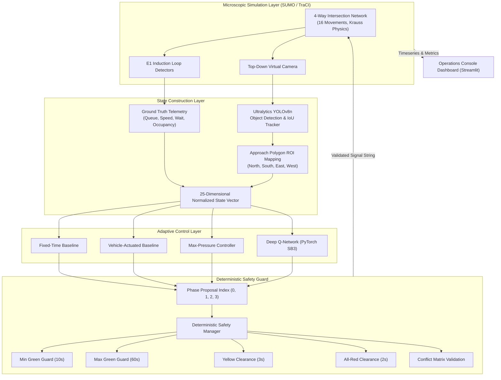

<div align="center">

# 🚦 AI & ML Based Adaptive Traffic Control System
**Microscopic Traffic Simulation • Deep Reinforcement Learning • Deterministic Safety Guard • YOLOv8 Perception**

[](https://github.com/termux37/AI-ML-Adaptive-Traffic-Signal-Controller/releases/tag/v1.0.0)
[](https://github.com/termux37/AI-ML-Adaptive-Traffic-Signal-Controller/actions)
[](https://www.python.org/)
[](https://pytorch.org/)
[](https://eclipse.dev/sumo/)
[](https://github.com/ultralytics/ultralytics)
[](https://streamlit.io/)
[](LICENSE)

<br/>

[Overview](#-overview) • [System Architecture](#-system-architecture) • [Signal Phases](#-signal-phase-catalog) • [Safety Guard](#-deterministic-signal-safety-manager) • [Control Regimes](#-control-regimes) • [Perception Pipeline](#-synthetic-vision-pipeline) • [Benchmark Analytics](#-benchmark-analytics) • [Tech Stack](#-technologies-used) • [Repository Structure](#-repository-structure) • [Literature References](#-research-papers--literature-references) • [Changelog](CHANGELOG.md) • [Contributing](CONTRIBUTING.md)

</div>

---

## 📌 Overview

Traditional municipal traffic management predominantly relies on static time-of-day plans (**Fixed-Time**) or localized detector triggers (**Vehicle-Actuated**). While predictable, these conventional regimes degrade during non-stationary travel demands, asymmetric directional surges, and temporary bottlenecks.

**AI & ML Based Adaptive Traffic Control System** is a simulation and evaluation testbed designed to assess how **Deep Reinforcement Learning (DQN)** and decentralized feedback control (**Max-Pressure**) perform against traditional traffic engineering baselines under identical microscopic conditions.

The platform simulates a 4-way signalized intersection with multi-lane approaches, protected left-turn pockets, and realistic driver car-following dynamics using **Eclipse SUMO**. A core architectural principle of this system is **safety-policy independence**: neural networks and heuristic algorithms never actuate signals directly. Instead, they emit target action proposals that are strictly intercepted, validated, and clearance-guarded by a deterministic safety finite-state machine.



---

## 🏛️ System Architecture

The simulation environment operates as a discrete-time control loop stepping at $1.0$-second resolution ($dt = 1.0\text{ s}$), evaluating control decisions at parameterized decision intervals (default $\Delta t = 5.0\text{ s}$).

### 1. Intersection Geometry & Vehicular Physics
- **Junction Node:** 4-way intersection (`junction_center`) with North, South, East, and West approach legs.
- **Lane Configuration:** 2 incoming lanes per leg (Lane 0: Through/Right, Lane 1: Dedicated Left-Turn Pocket) and 2 outgoing lanes, totaling 16 link connections.
- **Driver Model:** Krauss car-following dynamics with stochastic driver imperfection ($\sigma = 0.5$) and acceleration bounds ($a = 2.6\text{ m/s}^2$, $b = 4.5\text{ m/s}^2$).
- **Sensory Hardware:** E1 induction loops positioned on all incoming approach lanes recording vehicle presence, passage timestamps, and occupancy.

### 2. State Space Specification (25 Dimensions)
The Gymnasium environment constructs a 25-dimensional continuous state vector normalized to $[0.0, 1.0]$:

| Dimension Index | Feature Representation | Normalization Factor | Semantic Description |
| :---: | :--- | :---: | :--- |
| **0 – 4** | North Approach Metrics | — | Count ($/30$), Queue ($/30$), Speed ($/13.89\text{ m/s}$), Wait ($/300\text{s}$), Occupancy ($[0,1]$) |
| **5 – 9** | South Approach Metrics | — | Count ($/30$), Queue ($/30$), Speed ($/13.89\text{ m/s}$), Wait ($/300\text{s}$), Occupancy ($[0,1]$) |
| **10 – 14** | East Approach Metrics | — | Count ($/30$), Queue ($/30$), Speed ($/13.89\text{ m/s}$), Wait ($/300\text{s}$), Occupancy ($[0,1]$) |
| **15 – 19** | West Approach Metrics | — | Count ($/30$), Queue ($/30$), Speed ($/13.89\text{ m/s}$), Wait ($/300\text{s}$), Occupancy ($[0,1]$) |
| **20 – 23** | Current Phase ID | One-Hot | One-hot vector identifying the active green phase ($p \in \{0, 1, 2, 3\}$) |
| **24** | Elapsed Green Duration | $t_{green} / t_{max}$ | Normalized time spent in current green phase ($t_{max} = 60.0\text{ s}$) |

---

## 🚦 Signal Phase Catalog

The intersection utilizes a standard 4-phase dual-ring phasing scheme to eliminate turn conflicts:

| Phase Index | Designation | Signal State String (16 Links) | Permitted Movements | Opposing Conflicting Movements |
| :---: | :--- | :---: | :--- | :--- |
| **0** | `N_S_THRU` | `GGGgrrrrGGGgrrrr` | North & South Through + Right turns | East-West traffic & all left turns (HELD RED) |
| **1** | `N_S_LEFT` | `rrrGrrrrrrrGrrrr` | North & South Protected Left turns | All East-West movements & Through traffic |
| **2** | `E_W_THRU` | `rrrrGGGgrrrrGGGg` | East & West Through + Right turns | North-South traffic & all left turns (HELD RED) |
| **3** | `E_W_LEFT` | `rrrrrrrGrrrrrrrG` | East & West Protected Left turns | All North-South movements & Through traffic |

---

## 🛡️ Deterministic Signal Safety Manager

The reinforcement learning agent and heuristic controllers are isolated behind a **Deterministic Safety Manager**. Under no circumstance can a policy directly send raw signal commands to the simulation engine.

```
       [ Proposed Phase Index: j ]
                    |
      Is j == active_phase i ?
      ├── YES ──> Check max green timer. If t >= 60s, force transition.
      └── NO  ──> Check min green timer:
                    ├── If t < 10.0s ──> REJECT (Hold Phase i)
                    └── If t >= 10.0s ─> INITIATE CLEARANCE:
                                          │
                                          ▼
                         [ Display Yellow Phase i (3.0s) ]
                                          │
                                          ▼
                         [ Display All-Red Phase (2.0s) ]
                                          │
                                          ▼
                         [ Activate Green Phase j (t = 0.0s) ]
```

### Safety Invariants Enforced
* **Minimum Green Duration ($t_{min} = 10.0\text{ s}$):** Prevents phase hunting and rapid cycling; allows queue discharge and driver reaction.
* **Maximum Green Duration ($t_{max} = 60.0\text{ s}$):** Guarantees service bounds and prevents minority approach starvation.
* **Yellow Clearance Interval ($t_{yellow} = 3.0\text{ s}$):** Prevents dilemma-zone trapping for approaching traffic at design speed ($50\text{ km/h}$).
* **All-Red Clearance Interval ($t_{red} = 2.0\text{ s}$):** Provides clearance of intersection box geometry before granting conflicting green indications.
* **Non-Preemptible Clearance:** Phase switch requests issued during clearance intervals are discarded with `TRANSITION_IN_PROGRESS`.

---

## 🧠 Control Regimes

### 1. Fixed-Time Controller (Pre-Timed Baseline)
Cycles sequentially through phases with static green splits ($90.0\text{ s}$ total cycle length: Phase 0 = 33s, Phase 1 = 12s, Phase 2 = 33s, Phase 3 = 12s, including clearance intervals).

### 2. Vehicle-Actuated Controller (Demand-Responsive Baseline)
Extends green duration upon vehicle presence on active approach detectors. If the headway between consecutive vehicles exceeds the gap-out threshold ($3.0\text{ s}$), the phase terminates and advances to the next demanding approach, bounded by $t_{min}$ and $t_{max}$.

### 3. Max-Pressure Controller (Dynamic Optimization Baseline)
Implements decentralized queue differential feedback control (Varaiya 2013 / PressLight KDD 2019). The pressure $w(l, m)$ for movement from incoming lane $l$ to outgoing lane $m$ is calculated as:
$$w(l, m) = x_l - x_m$$
where $x_l$ is the queue count on incoming lane $l$, and $x_m$ is the downstream lane occupancy. The controller activates the phase $p^*$ that maximizes total dissipated pressure:
$$p^* = \arg\max_p \sum_{(l, m) \in \mathcal{M}(p)} w(l, m)$$

### 4. Deep Q-Network (DQN Reinforcement Learning Agent)
A deep Q-learning policy parameterized as a Multi-Layer Perceptron (PyTorch SB3 `MlpPolicy`, architecture `[128, 128]`). The agent selects green phase proposals to optimize long-term discounted rewards:
$$R_t = - w_q \sum_{a} Q_a - w_w \sum_{a} W_a + w_{th} N_{completed} - w_{sw} \mathbb{I}_{switch} - w_{starv} t_{starve}$$
* $w_q = 1.0$: Penalty for accumulated queue length
* $w_w = 0.05$: Penalty for accumulated waiting time
* $w_{th} = 2.0$: Bonus for completed trip throughput
* $w_{sw} = 2.0$: Penalty for initiating phase transitions (discourages chattering)
* $w_{starv} = 1.5$: Penalty proportional to maximum unserviced approach waiting time

---

## 📷 Synthetic Vision Pipeline

In addition to direct simulator ground truth, the platform supports closed-loop control driven by simulated top-down video cameras:

```
[ SUMO Vehicles ] ──> [ 2D Orthographic Renderer ] ──> [ YOLOv8n Inference ]
                                                              │
                                                              ▼
[ Control State ] <── [ Approach Polygon ROIs ] <── [ Spatial IoU Tracker ]
```

* **Object Detection:** Ultralytics YOLOv8n deep convolutional neural network performing real-time inference on orthographic frames, filtering classes `car`, `motorcycle`, `bus`, and `truck`.
* **Vehicle Tracking:** Frame-to-frame spatial IoU association tracker preserving persistent track IDs across frames.
* **Approach ROI Calibration:** Convex polygon mapping allocating detection centroids into North, South, East, and West approach queues.
* **Error Telemetry:** Computes Mean Absolute Error (MAE) and root-mean-square tracking errors between vision estimates and TraCI ground-truth queues.

---

## 📊 Benchmark Analytics

Empirically evaluated on synthetic demand scenarios with identical randomized vehicle arrival seeds ($seed = 101$):

| Scenario Profile | Controller Regime | Throughput (vph) | Avg Queue (veh) | Avg Wait (s) | Cross-Approach Fairness |
| :--- | :--- | :---: | :---: | :---: | :---: |
| **Balanced Traffic** | Fixed-Time | 840.0 | 7.77 | 126.3 | 0.84 |
| *(Equal Arrival Rates)* | Vehicle-Actuated | 900.0 | 7.38 | 124.7 | 0.73 |
| | **Max-Pressure** | **1,080.0** | **3.93** | **70.7** | 0.58 |
| | DQN Policy | 60.0 | 18.63 | 449.5 | 0.78 |
| **North-South Dominant** | Fixed-Time | 360.0 | 11.78 | 199.0 | 0.50 |
| *(Directional Imbalance)* | Vehicle-Actuated | 660.0 | 7.83 | 109.1 | 0.58 |
| | **Max-Pressure** | **1,080.0** | **2.67** | **36.9** | 0.43 |
| | **DQN Policy** | 840.0 | 7.93 | 107.2 | **0.88** |

> **Fairness Metric:** Jain's Fairness Index evaluates waiting time equity across the four approaches:
> $$\mathcal{J}(w_1, w_2, w_3, w_4) = \frac{\left(\sum_{i=1}^4 w_i\right)^2}{4 \cdot \sum_{i=1}^4 w_i^2}$$
> Under directional demand asymmetry, the learned **DQN policy** prevented cross-street starvation, achieving a fairness index of **0.88** compared to **0.43** for Max-Pressure and **0.50** for Fixed-Time.

---

## 💻 Technologies Used

| Layer / Subsystem | Technology | Function in System |
| :--- | :--- | :--- |
| **Simulation Core** | Eclipse SUMO (>= 1.20) | Microscopic vehicle kinematics, collision avoidance, network topology, lane logic |
| **Simulation API** | TraCI (libsumo / traci) | Socket-based bidirectional simulation stepping, detector polling, and signal state actuation |
| **Deep Learning & RL** | PyTorch, Stable-Baselines3 | Deep Q-Network implementation, experience replay memory, target network updates |
| **Environment Standard** | Gymnasium | Formal Markov Decision Process wrapper (observation/action spaces, step/reset lifecycle) |
| **Computer Vision** | Ultralytics YOLOv8 (`yolov8n`) | Deep learning object detection, bounding box regression, vehicle class filtering |
| **Tracking & Image Ops** | OpenCV, NumPy, SciPy | Spatial IoU association tracking, top-down frame rendering, polygon homography |
| **Data Contracts** | Pydantic (v2) | Strict schema validation for configurations, simulation states, metrics, and manifests |
| **Configuration** | PyYAML | Declarative parameters for simulation, RL hyperparameters, perception, and scenarios |
| **Data Processing** | Pandas | Timeseries aggregation, windowed metrics rollups, and CSV/JSON export serialization |
| **Operations UI** | Streamlit, Plotly, Altair | 11-page dark operations console, interactive telemetry, live animation streaming |
| **Verification & QA** | Pytest | Unit and integration test suite covering safety invariants, gym spaces, and TraCI execution |

---

## 📁 Repository Structure

```text
ai_ml_project/
├── app.py                          # Streamlit operations console entry point
├── pyproject.toml                  # Python package configuration and pytest settings
├── README.md                       # System architecture, specs, and literature references
├── LICENSE                         # MIT License
├── .gitignore                      # Git exclusion rules
├── .env.example                    # Environment variable template
├── launch.py                       # Unified test verification and startup pipeline
├── launch.bat                      # Windows batch startup launcher
├── launch.ps1                      # Windows PowerShell startup launcher
├── configs/
│   ├── app.yaml                    # Dashboard UI settings
│   ├── simulation.yaml             # SUMO network paths, timesteps, and TraCI settings
│   ├── perception.yaml             # Camera geometry, YOLO confidence, and approach ROIs
│   ├── rl.yaml                     # DQN hyperparameters and composite reward weights
│   └── experiments.yaml            # Benchmark scenario matrices and seed definitions
├── simulation/
│   ├── network/                    # SUMO node, edge, connection, net, and detector XMLs
│   ├── routes/                     # Deterministic traffic demand route profiles
│   ├── scenario.sumocfg            # Master SUMO configuration file
│   └── gui-settings.cfg.xml        # Desktop SUMO-GUI viewport and rendering configuration
├── src/traffic_ai/
│   ├── config/schemas.py           # Pydantic schemas and strict runtime data contracts
│   ├── simulation/                 # TraCI connection lifecycle and route scenario manager
│   ├── control/                    # Safety manager, phase catalog, and 4 signal controllers
│   ├── perception/                 # YOLO detector, IoU tracker, calibration, and video pipeline
│   ├── state/                      # Ground truth TraCI adapter and observation builder
│   ├── metrics/                    # Step metrics collector, stats aggregator, manifest generator
│   ├── training/                   # Gymnasium environment wrapper and DQN training loop
│   ├── experiments/                # Multi-seed multi-scenario benchmark evaluation runner
│   ├── dashboard/                  # Operations console pages and dark design system
│   └── utils/                      # Structured logging and diagnostics
├── scripts/
│   ├── check_environment.py        # Environment and dependency verification CLI
│   ├── generate_scenario.py        # Demand generation CLI
│   ├── run_simulation.py           # Standalone single-run simulation CLI
│   ├── train_agent.py              # DQN training CLI
│   ├── evaluate_agent.py           # Multi-controller benchmark CLI
│   └── make_demo_video.py          # Perception demo video generator CLI
└── tests/
    ├── unit/                       # Tests for safety invariants, environment spaces, and vision
    ├── integration/                # End-to-end multi-controller simulation pipeline tests
    └── smoke/                      # Environment and import smoke checks
```

---

## 📚 Research Papers & Literature References

The theoretical foundation, algorithmic formulations, and safety mechanisms in this project are based on the following published literature and technical standards:

### 1. Max-Pressure Control & Network Stability
* **Varaiya, P. (2013).** *The max-pressure controller for arbitrary networks of signalized intersections.* Advances in Dynamic Network Modeling in Complex Systems, pp. 27–66. Springer, Boston, MA.  
  *Context:* Mathematical proof establishing that decentralized queue differential feedback guarantees maximum network throughput without requiring prior knowledge of traffic arrival rates.
* **Wei, H., Chen, C., Zheng, G., Wu, K., Gayah, V., Xu, K., & Li, Z. (2019).** *PressLight: Learning Max Pressure Control to Coordinate Traffic Signals in Arterial Networks.* Proceedings of the 25th ACM SIGKDD International Conference on Knowledge Discovery & Data Mining (KDD '19), pp. 1290–1298.  
  *Context:* Unifies Max-Pressure control theory with deep reinforcement learning by demonstrating that reward functions minimizing pressure changes stabilize queue dynamics.

### 2. Reinforcement Learning for Traffic Signal Control
* **Mnih, V., Kavukcuoglu, K., Silver, D., Rusu, A. A., Veness, J., Bellemare, M. G., ... & Hassabis, D. (2015).** *Human-level control through deep reinforcement learning.* Nature, 518(7540), pp. 529–533.  
  *Context:* Foundation for deep Q-networks (DQN) with target network stabilization and experience replay used in this project's learning policy.
* **Wei, H., Zheng, G., Yao, H., & Li, Z. (2018).** *IntelliLight: A Reinforcement Learning Approach for Intelligent Traffic Light Control.* Proceedings of the 24th ACM SIGKDD International Conference on Knowledge Discovery & Data Mining (KDD '18), pp. 2496–2505.  
  *Context:* Formulates phase-duration state representations and multi-objective composite reward functions (queue, delay, phase chatter) for signalized junctions.
* **Chen, C., Wei, H., Xu, N., Zheng, G., Yang, M., Xiong, Y., Xu, K., & Li, Z. (2020).** *Toward a Thousand Lights: Decentralized Deep Reinforcement Learning for Large-Scale Traffic Signal Control.* Proceedings of the AAAI Conference on Artificial Intelligence, 34(04), pp. 3414–3421.  
  *Context:* Investigates decentralized observation formulations and communication-efficient policies across independent intersection controllers.
* **Ault, J., & Sharon, G. (2021).** *Reinforcement Learning Benchmarks for Traffic Signal Control (RESCO).* Thirty-fifth Conference on Neural Information Processing Systems (NeurIPS 2021) Datasets and Benchmarks Track.  
  *Context:* Standardized evaluation protocols, scenario configurations, and baseline comparisons for traffic signal RL algorithms.

### 3. Microscopic Traffic Modeling & Car-Following Dynamics
* **Lopez, P. A., Behrisch, M., Bieker-Walz, L., Erdmann, J., Flötteröd, Y. P., Hilbrich, R., Lücken, L., Rummel, J., Wagner, P., & Wießner, E. (2018).** *Microscopic Traffic Simulation using SUMO.* The 21st IEEE International Conference on Intelligent Transportation Systems (ITSC 2018), pp. 2575–2582.  
  *Context:* Foundational paper for Eclipse SUMO, detailing TraCI socket architecture, induction loop modeling, and traffic light controller interfaces.
* **Krauss, S., Wagner, P., & Gawron, C. (1997).** *Metastable states in a microscopic model of traffic flow.* Physical Review E, 55(5), pp. 5597–5602.  
  *Context:* Stochastic car-following model used for vehicle kinematics, safe following distance calculation, and collision avoidance in the simulation network.

### 4. Traffic Signal Timing Standards & Engineering Fundamentals
* **Federal Highway Administration (FHWA). (2009 / 2023).** *Manual on Uniform Traffic Control Devices for Streets and Highways (MUTCD).* U.S. Department of Transportation.  
  *Context:* Standardized federal specifications for signal phase sequences, minimum green durations, yellow change intervals, and red clearance calculations.
* **Roess, R. P., Prassas, E. S., & McShane, W. R. (2010).** *Traffic Engineering* (4th ed.). Pearson Prentice Hall.  
  *Context:* Kinematic equations for dilemma-zone clearance times, approach design speeds, and intersection delay models.
* **Webster, F. V. (1958).** *Traffic Signal Settings.* Road Research Technical Paper No. 39. Road Research Laboratory, HMSO, London.  
  *Context:* Classical mathematical derivation of optimal cycle lengths and green splits used in the Fixed-Time controller baseline.
* **Gordon, R. L., & Tighe, W. (2005).** *Traffic Control Systems Handbook.* Federal Highway Administration, Report FHWA-HOP-06-006.  
  *Context:* Standard reference for vehicle-actuated signal operations, passage time calculations, detector placement, and gap-out logic.

### 5. Computer Vision & Vehicle Tracking
* **Jocher, G., Chaurasia, A., & Qiu, J. (2023).** *Ultralytics YOLOv8.* Version 8.0.0. GitHub repository: https://github.com/ultralytics/ultralytics.  
  *Context:* Deep convolutional neural network detector applied for multi-class vehicular bounding box regression and classification.
* **Bewley, A., Ge, Z., Ott, L., Ramos, F., & Upcroft, B. (2016).** *Simple online and realtime tracking.* 2016 IEEE International Conference on Image Processing (ICIP), pp. 3464–3468.  
  *Context:* Algorithmic foundation for spatial intersection-over-union (IoU) vehicle tracking used in the virtual camera perception module.

### 6. Quantitative Fairness & Allocation Equity
* **Jain, R., Chiu, D. M., & Hawe, W. (1984).** *A Quantitative Measure of Fairness and Discrimination for Resource Allocation in Shared Computer Systems.* Technical Report TR-301, Digital Equipment Corporation.  
  *Context:* Mathematical formulation of Jain's Fairness Index used to assess whether controllers equitably balance delay across all four approach legs.

---

<div align="center">
  <sub>Developed for academic research and simulation evaluation. Compliant with Eclipse SUMO microscopic modeling and Gymnasium RL standards.</sub>
</div>
